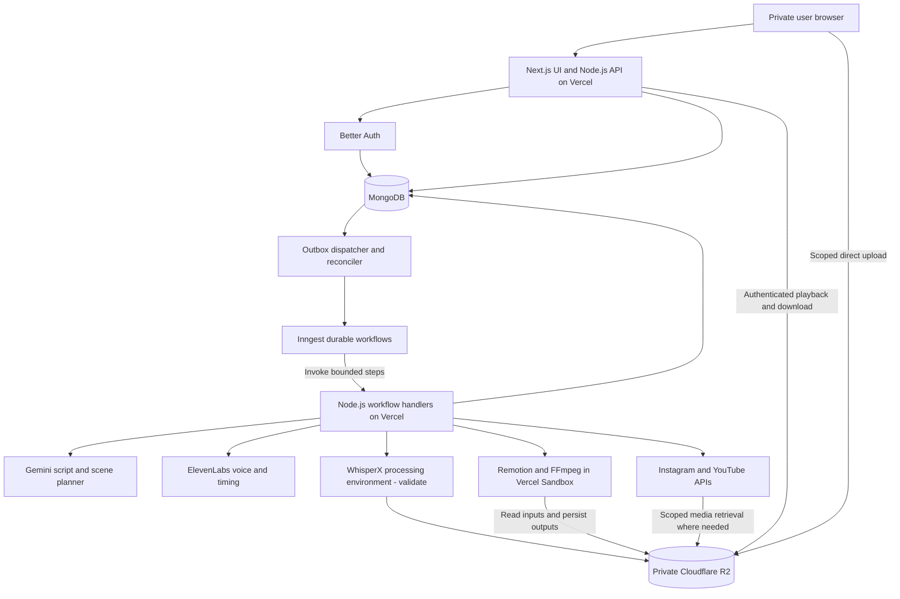
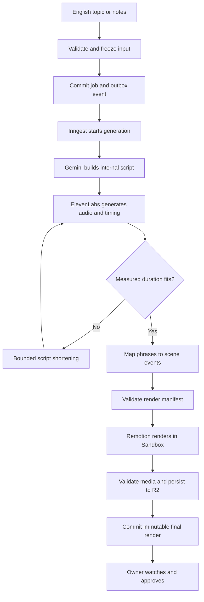
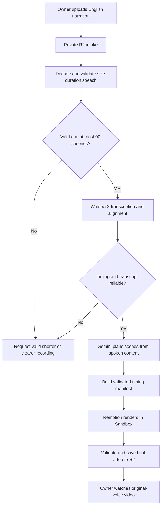

# VidSprout.ai — V1 System Architecture

**Your ideas. Your voice. Your videos.**

**Date:** 22 October 2026  
**Status:** Architecture proposal for implementation; not a deployed system  
**Requirements:** [PRD V1, revision 6](./PRD-V1.md)  
**Next executable milestone:** [Technical prototype plan](./PROTOTYPE-PLAN-V1.md)

## 1. What this design achieves

One signed-in person supplies an English topic/notes or a voice recording. The system creates a final, immutable video, with synchronized speech, animation, and captions, in no more than 90 seconds of playback. Vertical is the default; landscape is a pre-generation option. The owner can watch/download privately or approve a specific render for Instagram/YouTube publication.

There is no generated-video editor, sharing workspace, billing UI, or public library. Posting details can be edited; video content cannot. The PRD remains authoritative for product scope. This document proposes implementation details, not new product features or authorization to incur charges.

## 2. Overall architecture



Arrows describe logical service calls/data movement. Inngest orchestration does not mean Inngest itself hosts every computation: handlers are exposed by the Next.js application, while heavy work runs in Sandbox or the selected transcription environment. The outbox dispatcher is application logic invoked immediately after commit and by a periodic Inngest reconciliation function, not an extra paid queue service.

### Service responsibilities

| Component | Owns | Does not own |
|---|---|---|
| Next.js / Node.js on Vercel | UI, authenticated APIs, input validation, workflow handlers, social OAuth callbacks | Long-running render loops inside a user HTTP request |
| Better Auth | Registration, password verification, sessions through MongoDB adapter | Social publishing authorization or project ownership checks by itself |
| MongoDB | Owners, immutable input snapshots, jobs, outbox, assets metadata, approvals, publication state | Video/audio file payloads |
| R2 | Private originals, narration, manifests, thumbnails, final exports | Access decisions based merely on a path prefix |
| Inngest | Durable steps, retries, concurrency, delayed posting, cleanup orchestration | Exactly-once provider effects or persistent render files |
| Vercel Sandbox | Isolated Remotion/FFmpeg computation with bounded resources | Durable storage, application sessions, indefinite background processes |
| Gemini | Internal script and structured scene suggestions | Trusted executable code or final timestamp authority |
| ElevenLabs | AI narration and character alignment | Visual rendering or a guarantee of free commercial use |
| WhisperX | Uploaded-speech transcription and alignment | Editing uploaded narration or guaranteed real-time CPU processing |

Remotion documents a Vercel rendering route; Better Auth supports MongoDB; Inngest supports Next.js handlers and durable scheduling. These establish integration options, not demonstrated capacity for this project. [R1–R4]

## 3. Boundaries and product-facing flow

1. **Add content:** Save original input or complete a validated private upload.
2. **Confirm basic options:** Select orientation and narration mode. Use one curated default English voice for the prototype; a production voice selector remains a PRD decision.
3. **Generate and watch:** Submit immutable input, return a job ID immediately, display persisted progress, then show the final MP4. No editor.
4. **Download, publish, or schedule:** Download privately; or approve the exact render and confirm destination, post text, and timing.

The UI polls an owner-scoped status endpoint with backoff (proposed: 3 seconds initially, then 10 seconds during longer stages). A refresh re-reads MongoDB. Live streaming updates are not required for V1. Progress labels reflect real stages, not invented percentages.

## 4. Identity, authorization, and private media

- Configure Better Auth email/password with its MongoDB adapter and supported indexes. Use maintained password handling, secure cookies, origin/CSRF protections, and generic login errors. Signup collects name/email/password; no email-link login.
- Use the verified session's immutable user ID as `ownerId`. A submitted owner ID is ignored, not trusted.
- Every project, asset, job, approval, connection, and post lookup includes owner scope. Lists, search counts, thumbnails, byte-range playback, downloads, and retry/cancel routes follow the same rule.
- Better Auth's credential collections remain library-managed. Business logic stores only a reference to the auth user, never another copy of password material.
- Password recovery remains a launch gate. An emailed one-time reset is proposed, separate from everyday login, but no provider is selected.
- Social OAuth uses state tied to the signed-in account and a short-lived connection attempt. Encrypt social tokens server-side; never expose them in browser or Inngest payloads.
- Use one private R2 bucket per environment or strictly separated environment namespaces. Paths resemble `owners/{ownerId}/projects/{projectId}/jobs/{jobId}/...`; path naming is organizational, not authorization.
- For prototype playback/download, stream through an authenticated Node.js route supporting Range requests. Validate Vercel transfer/runtime limits with actual output sizes; optimize delivery only if the benchmark requires it.
- Scoped R2 signed URLs are used for direct uploads and backend/provider transfers. They are bearer credentials valid until expiry, not private share links. Never log them or store them as permanent object identity. [R5]
- Browser upload completion is not trusted: inspect object metadata and actual decoded content. Detect over-limit uploads after upload and delete/quarantine them; signing Content-Type alone does not enforce a byte cap.
- Restrict CORS to application origins; it is not an authentication mechanism. Keep bucket listing and public development URLs disabled.
- Cache private responses safely; no shared caching of owner data. Clear UI caches on logout/account change. No team/gallery/public-profile routes.

## 5. Data design and invariants

Use explicit schema versions and UTC timestamps. Proposed collections:

| Collection | Important fields | Index/invariant |
|---|---|---|
| Better Auth collections | Library-managed users/accounts/sessions | Official adapter constraints; user email uniqueness |
| `projects` | ownerId, inputDraft, inputMode, orientation, state, activeJobId, finalRenderId, deletedAt | Owner + updatedAt; completed audiovisual content cannot be patched |
| `jobs` | ownerId, projectId, snapshot, inputHash, stage, state, attempts, lease, cancelRequested, providerRefs | Unique owner + requestKey; one active generation per owner using an atomic owner-slot reservation |
| `jobAttempts` | jobId, stage, attemptId, externalState, requestId, sandboxId, outputKey, errors | Unique job + stage + attempt; records ambiguous external submission |
| `assets` | ownerId, objectKey, checksum, type, byteSize, durationMs, status, provenance | Unique objectKey; only validated assets usable |
| `renders` | ownerId, jobId, outputAssetId, manifestHash, mediaProperties, qa, templateBuild | Unique jobId for the selected successful final render |
| `approvals` | ownerId, renderId, checksum, approvedAt | Immutable render/checksum binding |
| `connections` | ownerId, platform, remoteAccountId, encryptedCredentials, scope, state | Unique owner + platform in V1; remote identity shown to owner |
| `posts` | ownerId, renderId, approvalId, connectionId, metadata, dueAt, zone, revision, state, providerRefs | dueAt/state for recovery; owner + requestKey unique |
| `outbox` | eventId, kind, aggregateId, revision, state, attempts, nextAttemptAt | Unique eventId; pending state + nextAttemptAt |
| `operations` | correlationId, transition, timings, sanitized error | Retention bounded; no raw input/media/secrets by default |

Use a MongoDB deployment supporting transactions for multi-document intent/outbox and owner-slot writes. Do not silently fall back to non-atomic creation if unavailable. Adapter transaction configuration must match the chosen deployment. External API calls belong after commit, never inside a retryable DB transaction. [R2]

### Essential invariants

1. Every asset/job/post belongs to exactly one account.
2. A generation snapshot cannot change after acceptance.
3. A successful job has a validated, durable R2 output and final render record.
4. A post references an approved immutable render; metadata changes never change video bytes.
5. A deleting/canceled project cannot be revived by a late worker.
6. “Unknown provider outcome” is not “safe to retry.”
7. One owner slot is released on completion/cancel/failure; a reconciler detects expired leases without starting duplicate external work.

## 6. Pipeline A — Topic or notes to video



| Stage | Input → output | Validation/recovery |
|---|---|---|
| Admit | English input/basic options → immutable job | Auth, proposed 5,000-character cap, orientation, owner concurrency, available capacity |
| Plan script | Snapshot → structured script and semantic outline | Validate schema, English output, source facts, allowlisted scene kinds; no arbitrary code or external URLs |
| Generate voice | Script + pinned voice/model → R2 audio + timing | Record request intent before call; persist result promptly; unknown submissions require reconciliation rather than unlimited resubmission |
| Measure | Audio → real duration | Inspect audio, not word count; no more than two internal shortening attempts; fail with narrower-input guidance if still too long |
| Build scenes | Spoken phrases + outline → timed scene manifest | Use actual timings; preserve source meaning; automatically choose supported template/illustrations or permitted stock assets |
| Render | Valid manifest + private assets → attempt output | Sandbox startup/build/browser/render limits; poll using durable steps; no single long-running API request |
| Finalize | Attempt output → verified R2 artifact + final record | Check checksum, stream durations, dimensions, decode, captions/layout; commit only if job still current/not canceled |

The first proof uses a built-in animated explainer template and no stock footage/music to isolate the critical path. This is prototype scope only; it does not remove the PRD's supported styles from full V1.

## 7. Pipeline B — Uploaded voice to animation



- Presign one owned input key; complete intake only after object inspection. Proposed caps: MP3/WAV/M4A, 25 MB, 90 seconds.
- Preserve original uploaded bytes separately. Decode a processing copy with any offset/resampling mapping; do not trim silence, speed up speech, or synthesize a replacement voice silently.
- Use English transcription/alignment and annotate uncertainty internally. Reject non-speech or unusable overlapping/noisy input with understandable guidance.
- WhisperX runs outside ordinary Next.js requests. First benchmark a pinned CPU setup in a separate Sandbox task; load model dependencies reproducibly and record cold-start cost. Its support for CPU execution does not prove the selected Sandbox is fast or large enough. [R7]
- The scene planner receives the transcript as content; it cannot rewrite what the user said. Captions map to that audio, not a newly generated script.
- Use the common manifest/render/finalization pipeline. Failed alignment can use phrase-level captions only when the phrase alignment passes quality checks; otherwise request clearer input.

## 8. Timing and render manifest

Proposed versioned manifest shape (contract, not executable code):

```json
{
  "schemaVersion": 1,
  "jobId": "job_id",
  "templateBuild": "immutable_build_id",
  "orientation": "vertical",
  "width": 720,
  "height": 1280,
  "fps": 30,
  "durationFrames": 960,
  "narration": {"assetId": "audio_id", "durationMs": 32000},
  "captions": [{"startMs": 0, "endMs": 1700, "text": "Water changes into vapor."}],
  "scenes": [{
    "templateId": "concept-explainer-v1",
    "startFrame": 0,
    "endFrameExclusive": 960,
    "heading": "Evaporation",
    "events": [{"frame": 18, "kind": "reveal-label", "text": "Heat"}],
    "assetIds": []
  }]
}
```

No signed URLs, secrets, generated JavaScript, or arbitrary shell commands are persisted in this manifest. Resolve owned asset IDs into scoped access at execution time. Layout/template code is trusted, versioned application code; model output only supplies bounded data.

### Timing algorithm

1. Plan content length using language/voice estimates, but generate/measure audio before finalizing scene lengths.
2. Normalize ElevenLabs character timing into word/phrase ranges using the normalized spoken-text alignment where appropriate; numbers may be spoken differently from written input. Missing alignment is handled, not assumed impossible. [R6]
3. Use measured audio as the master clock. Anchor scene emphasis to phrases; do not ask the model to invent precise timestamps.
4. Store milliseconds, derive frames from absolute timestamps, and use half-open frame ranges. Validate bounds and monotonic ordering; avoid repeated incremental rounding.
5. At 30 fps, final video has at most 2,700 frames. Calculate frames from measured content; inspect encoded audio/video durations separately for padding/encoder effects. Never cut speech to repair the cap. Exact-boundary failure requests a shorter uploaded source or internally shortens AI script.
6. Run template fit rules before rendering: max text bounds, wrapping, caption-safe areas, missing fonts/assets, and non-overlapping labels. Bounded automatic repair occurs before presenting success.
7. Evaluate the PRD target on annotated samples: 95% of caption/visual cue onsets within 250 ms, no sustained drift over 500 ms. These are prototype measurements, not current claims.

## 9. Workflow execution, dispatch, and recovery

### API submission transaction

Validate session/input; reserve an account's generation slot; insert immutable job and outbox record; commit; return `202` with job ID. A repeated client request key returns the same job. A different request while the owner slot is busy gets a clear conflict/queue response.

After commit, attempt immediate Inngest event dispatch. An Inngest periodic reconciler discovers undelivered outbox records and retries delivery. Event IDs are deterministic per intent/revision. Marking dispatched after delivery is safe against duplicates only because consumers also check job state and IDs.

### Durable stages

Use stable stage names such as `validate-input-v1`, `plan-script-v1`, `create-voice-v1`, `build-manifest-v1`, `launch-render-v1`, `check-render-v1`, and `finalize-v1`. Long operations return external IDs; subsequent durable steps sleep/poll. A durable sleep does not keep a Vercel function or Sandbox running solely to wait. [R3, R4]

Application records remain the user-facing truth. Inngest's execution history aids orchestration/debugging but must not be the only durable record of outputs or approval.

### State transitions

`draft → queued → validating → planning/transcribing → voice/alignment → rendering → verifying → ready`

Any active stage can transition to `retry_wait`, `needs_action`, `failed`, or `cancel_requested`. Cancellation ends as `canceled` only after in-flight effects are handled. Readiness does not imply approval or publication.

### Failure policy

| Failure | Response |
|---|---|
| Invalid input or unsupported content | No automatic retry; preserve input and explain correction |
| Explicit transient provider rejection/rate limit | Bounded backoff honoring Retry-After; avoid repeated expensive work |
| Voice/Sandbox request times out after submission | Record unknown outcome; reconcile by external ID where possible; pause if safe reconciliation cannot establish a retry |
| Worker crashes after R2 upload | Probe expected attempt object and verify before rerendering |
| Render succeeds but upload fails | Retry upload while instance exists; otherwise new controlled render attempt |
| Database update fails after side effect | Reconcile side-effect record; never assume absence of commit means absence of effect |
| Cancellation during provider call | Stop future stages, reconcile result, discard unpublished artifacts; cleanup independently |
| Sandbox expires/OOM | Record resource failure, bounded retry using benchmarked settings; no endless scaling or paid escalation |
| Free allowance unavailable | Stop/pause affected operations; do not silently switch to paid service |

Proposed general retry cap: three clearly safe transient attempts per generation stage. PRD's publishing-specific retry/grace policy remains separate. Unknown-outcome handling overrides retry counts.

## 10. Rendering implementation boundary

- Use Remotion's supported Vercel integration where compatible with direct R2 output; validate the pinned API before implementation. Do not add Vercel Blob as permanent storage just because a sample uses it. [R1]
- Build a reproducible render bundle/snapshot with Chromium, fonts, Remotion, and media tools. Use immutable build identifiers. Browser/runtime/font versions affect output.
- Sandbox receives the manifest and narrow asset access, not database credentials or all provider keys. Upload through restricted object access for that attempt.
- Store Sandbox ID and lease before subsequent work; reconcile ambiguity around creation. No guarantee of a transaction across MongoDB and Sandbox APIs.
- Proposed QA: media decode probe, correct dimensions/codecs, duration cap, audible narration, known scene coverage, automated layout bounds, and sampled visual inspection in the prototype. A probe alone does not establish semantic correctness.
- Persist final MP4, thumbnail, QA metadata, and manifest in R2/MongoDB before job success. Keep originals private. Stop the Sandbox in a finally/cleanup path and have an orphan sweeper as backup.
- Pin a successful final object/checksum; rejected late workers cannot overwrite it. Retries use different attempt keys.

## 11. Publishing and scheduling architecture

One explicit confirmation creates separate post intents for each selected platform. Each stores owner, immutable render/checksum, approval, destination, metadata, required declarations, timezone, UTC due time, and revision.

1. Commit post/outbox atomically and dispatch an Inngest scheduling event.
2. Sleep until preparation time using durable scheduling. For immediate posts, start preparation now.
3. Recheck current revision, owner connection, approval, cancellation, media existence, quota, and compatibility.
4. Upload/process ahead where supported, keeping content private/unpublished. Store every provider ID.
5. Sleep until due time; recheck current state/revision and publish authorization immediately before the external effect.
6. Confirm provider outcome, update status/link, and expose result in the owner's calendar.

Use application-owned scheduling for V1: YouTube private upload followed by due-time visibility update; Instagram unpublished media container followed by publish when ready. Validate platform specs and container lifetime in the integration spike. Do not combine this with native scheduling for the same intent.

Proposed scheduling window is 15 minutes to 30 days ahead. Use stored UTC plus IANA timezone/offset for display and DST validation. These limits and the processing lead time require benchmarks.

Reschedule increments revision and emits cancellation/update. Both old and new workflows check MongoDB before effects; Inngest cancellation cannot undo an HTTP request already accepted by a social platform. Freeze modifications while final submission is in flight and reconcile before accepting conflicting changes.

Partial success is normal: YouTube published + Instagram failed remains two outcomes. Unknown publication result never triggers a blind second upload. PRD grace window, bounded retries, and missed-post recovery apply. A global readiness reconciler catches overdue intents; it does not publish stale posts without authorization.

## 12. Proposed application API surface

All business routes authenticate and enforce ownership; route names are proposed, not current endpoints.

| Route | Purpose |
|---|---|
| Better Auth integration routes | Signup/login/logout/session and approved recovery |
| `POST /api/projects` | Create editable input draft, not an editable video |
| `PATCH /api/projects/:id/input` | Update input only before generation submission |
| `POST /api/uploads` / `POST /api/uploads/:id/complete` | Authorized R2 intake and verified completion |
| `POST /api/projects/:id/generate` | Freeze snapshot; enqueue idempotent job |
| `GET /api/jobs/:id` | Owner-scoped stage/status |
| `POST /api/jobs/:id/retry` or `/cancel` | Safe technical recovery/cancellation |
| `GET /api/videos` / `GET /api/videos/:id` | Private final library |
| `GET /api/assets/:id/content` | Authorized media stream/download |
| `POST /api/videos/:id/approve` | Record exact render/checksum approval |
| Social connect/callback routes | Authorize a publishing destination |
| `POST /api/posts` | Confirm immediate/scheduled post intents |
| `PATCH /api/posts/:id` | Confirm metadata/schedule revision before in-flight submission |
| `POST /api/posts/:id/cancel` | Cancel/reconcile pending publication |
| `DELETE /api/projects/:id` | Tombstone, cancel/reconcile, and initiate retention cleanup |
| Inngest serve route | Signed service calls; not a public user job-admission route |

## 13. Operations, environments, and testing

- **Operator/user boundary:** Infrastructure configuration and diagnostics are operator responsibilities. The end-user app has no Settings navigation or infrastructure panel. R2, Better Auth/MongoDB, Vercel Sandbox, Inngest, keys, and render-enablement controls stay in server-side deployment configuration and operator tooling. No user-facing admin console is introduced in V1.
- Send only product-level availability flags to client components; do not serialize provider readiness or configuration inventories into page props. Map infrastructure failures to plain-language user messages, with technical details confined to protected operator logs.
- Keep account identity/sign-out in the account menu. Put Instagram/YouTube connect, reconnect, disconnect, and destination identity in the publishing flow; timezone selection belongs in scheduling. These are user authorizations, not infrastructure setup.
- UI acceptance checks cover navigation, account dialogs, error states, and client props for provider/configuration leakage, alongside the existing account-isolation checks.

- Separate local/test/staging/production credentials, R2 namespaces, databases, Inngest environments, and social destinations. Preview deployments cannot publish to production accounts.
- Keep secrets in server-side environment configuration. No secrets in Remotion public bundles, event payloads, or logs. Use scoped credentials and rotate on exposure.
- Correlate owner-safe project/job/stage/attempt IDs with provider IDs, queue time, cold start, transcription time, render time, output duration, and R2 persistence time.
- Internal cost/allowance metrics include speech characters, script tokens, Sandbox CPU/memory/runtime, R2 storage/operations, and Inngest step/execution usage. This is not a customer credit screen.
- No promised hard spend cap unless each provider's enforcement is verified. Application admission estimates and alerts reduce risk but are not a substitute for provider billing controls.
- Cleanup tombstones take precedence over late completions. Hold assets needed by active schedules; TTL rules cannot delete them indiscriminately.
- Test domain rules independently, provider adapters with mocked failures, then real narrow integration runs. Use two independent accounts to test access boundaries. Prototype fixtures never prove live provider integration.
- Pass the PRD Definition of Done only after actual end-to-end evidence, not architecture completion.

## 14. Decisions and risk register

| Item | Design recommendation | Evidence needed / status |
|---|---|---|
| Render platform | Remotion on Sandbox, R2 output | Selected; benchmark actual 30/60/90-second jobs and cold starts |
| Transcription | Separate CPU WhisperX Sandbox task first | Proposed experiment; model load, memory, quality, latency, licenses unresolved |
| English voice | One curated Flash v2.5-compatible voice for prototype | Validate timestamps/model/voice access; commercial ElevenLabs needs appropriate terms |
| Commercial vs personal launch | Explicitly classify before selecting plans | User decision remains open; no assumption that absence of billing makes use non-commercial |
| Vercel/Remotion eligibility | Check account/organization terms | No paid plan or license purchase authorized |
| Free quotas | Test within verified allowances | Inngest/R2/Sandbox are bounded services, not unlimited free infrastructure |
| Source/output defaults | PRD-proposed 5,000 characters, 25 MB/90 seconds, 720p | Prototype defaults; confirm before locking release limits |
| Password recovery | Better Auth reset flow plus selected mail provider | Delivery/domain configuration and user approval still needed |
| Voice selector | Default voice in prototype; keep provider adapter ready | Production selector vs automatic voice remains undecided |
| Media gateway | Authenticated streaming for owner access | Benchmark Vercel transfer limits/cost; no silent public-bucket fallback |
| Social access | Validate both platforms in parallel with core prototype | Permissions, app access, valid media, review and processing behavior |

An unresolved launch dependency need not prevent writing or locally testing code. It does prevent claiming production readiness or spending without authorization. If Sandbox transcription or free commercial voice is infeasible, record the measured issue and propose a targeted change rather than silently replacing the agreed stack.

## 15. Documentation references

Checked 22 October 2026. Pin versions during implementation and recheck terms before provisioning. The architecture above is our proposed design, not a vendor guarantee.

- **R1:** [Remotion on Vercel](https://www.remotion.dev/docs/vercel)
- **R2:** [Better Auth MongoDB adapter](https://better-auth.com/docs/adapters/mongo), [email/password](https://better-auth.com/docs/authentication/email-password)
- **R3:** [Inngest Next.js integration](https://www.inngest.com/docs/getting-started/nextjs-quick-start)
- **R4:** [Inngest sleepUntil](https://www.inngest.com/docs/reference/typescript/v4/functions/step-sleep-until), [cancellation boundaries](https://www.inngest.com/docs/durable-execution/guides-and-advanced/cancellation/bulk-cancellation)
- **R5:** [R2 presigned URLs](https://developers.cloudflare.com/r2/api/s3/presigned-urls/), [pricing](https://developers.cloudflare.com/r2/pricing/)
- **R6:** [ElevenLabs speech with timing](https://elevenlabs.io/docs/api-reference/text-to-speech/convert-with-timestamps), [commercial-use terms](https://help.elevenlabs.io/hc/en-us/articles/13313564601361-Can-I-publish-the-content-I-generate-on-the-platform)
- **R7:** [WhisperX repository and limitations](https://github.com/m-bain/whisperX)
- **R8:** [Sandbox quotas/pricing](https://vercel.com/docs/sandbox/pricing), [Vercel terms](https://vercel.com/legal/terms)
- **R9:** [Inngest pricing](https://www.inngest.com/pricing), [Remotion license](https://www.remotion.dev/docs/license/faq)

## 16. Recommended next action

Execute the narrow prototype plan before implementing the complete dashboard. The first decisive result is a real topic-to-video job, rendered in Sandbox, saved privately to R2, and retrieved by its owner—with measured synchronization and resource use. Then validate uploaded narration and scheduling. No deployment, credentials, purchases, or live posting have been performed as part of this architecture task.
